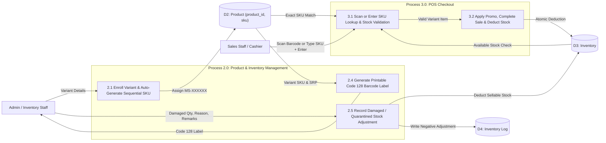
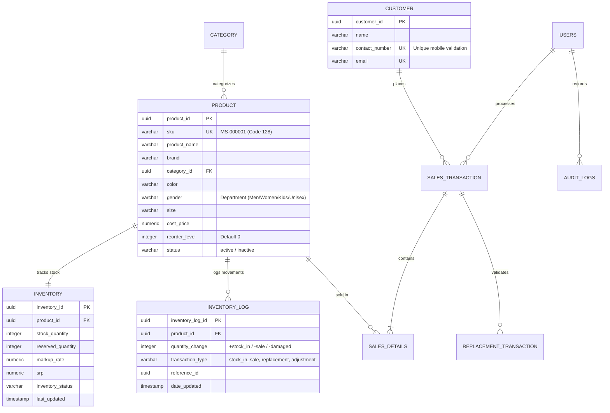

# Complete Manuscript Revision Guide (`papers/FINAL PAPERS.pdf`)
**System**: Integrated POS-Driven Inventory with Data Analytics for Targeting Sales Marketing (Meryl Shoes)

This document contains the exact page-by-page, figure-by-figure, and table-by-table revisions for `papers/FINAL PAPERS.pdf` reflecting all implemented system updates:
1. **Variant-Level Sequential SKU (`MS-000001`) & Code 128 Barcode Label Generation**
2. **POS Barcode Scanning & Manual SKU Entry (`Scan or enter SKU`)**
3. **Authorized Damaged / Quarantined Stock Adjustment Workflow with Full Audit Trail**
4. **Actual Completed-Sales Percentage Formula in Analytics**
5. **Department Analytics (`Men`, `Women`, `Kids`, `Unisex`)**
6. **Unique Walk-in Customer Mobile Number Enforcement in POS**
7. **Default `reorder_level = 0` for Newly Added Products Before Stock-In**

---

## 1. Abstract & Chapter I: Introduction (Pages vii, 1–16)

### A. Abstract (Page vii)
Insert the following sentence into the second paragraph of the Abstract:
> *"Each footwear size and color variant is assigned a permanent sequential Stock Keeping Unit (SKU) encoded in a Code 128 barcode label, enabling both plug-and-play USB barcode scanning and manual SKU entry at checkout, alongside auditable damaged-stock write-offs and actual completed-sales percentage analytics."*

### B. Objectives of the Study (Pages 6–7)
Update **Specific Objectives 1 and 3**:
1. **Specific Objective 1**:
   > *"1. To design and develop an integrated Point-of-Sale (POS) and Inventory Management module featuring variant-level SKU assignment, Code 128 barcode label generation, scanner- and keyboard-ready POS lookup, unique customer mobile number validation, and auditable damaged-stock adjustments."*
2. **Specific Objective 3**:
   > *"3. To generate descriptive and predictive analytics—including actual sales percentages across product categories and target departments (Men, Women, Kids, Unisex)—derived strictly from completed sales transactions."*

### C. Scope and Limitations (Pages 8–10)
- **Under Scope**:
  > *"The system automatically generates a permanent sequential SKU (`MS-000001` format) and a printable Code 128 barcode label for every footwear size and color variant. During POS checkout, the `Scan or enter SKU` field supports both plug-and-play USB barcode scanners (acting as standard HID keyboard input) and manual SKU entry by staff."*
- **Under Limitations**:
  > *"Internal store labels use the Code 128 barcode standard rather than EAN-13, as EAN-13 requires paid GS1 company prefix registration."*

### D. Definition of Terms (Pages 13–16)
Replace or insert the following operational terms in alphabetical order:

- **Actual Sales Percentage** refers to the proportion of a specific product, category, or department’s sales relative to total store sales. In this study, it refers to the analytics metric computed as $\text{Segment Completed Revenue or Units} \div \text{Total Completed Revenue or Units} \times 100$, excluding cancelled transactions and fully returned items.
- **Barcode Label (Code 128)** refers to a high-density linear barcode symbology capable of encoding alphanumeric characters. In this study, it refers to the printable internal store label generated by the system containing the Meryl Shoes header, product name, brand, color, EU size, selling price (SRP), scannable Code 128 barcode, and human-readable SKU.
- **Damaged Stock Adjustment** refers to the physical and accounting deduction of unsellable or defective merchandise from active inventory. In this study, it refers to the authorized system workflow that deducts damaged or quarantined pairs (`Damaged Write-off` or `Quarantined`) from sellable stock and records a complete audit trail without deactivating remaining sellable units of the same variant.
- **Data Analytics** refers to the process of examining and interpreting data to identify patterns, trends, and insights that support decision-making. In this study, it refers to the system feature used to analyze sales performance, product movement, department segmentation, and marketing-related data in Meryl Shoes.
- **Department Analytics** refers to the segmentation of sales and inventory performance by target wearer group. In this study, it refers to the descriptive analytics breakdown categorizing footwear performance into Men, Women, Kids, and Unisex departments.
- **Descriptive Analytics** refers to the process of analyzing past and current data to understand what has happened in a business operation. In this study, it refers to the system feature that shows sales trends, actual sales percentages, best-selling products, slow-moving products, department breakdowns, and inventory performance.
- **Fragmented System** refers to a setup where business processes are handled using separate and unconnected tools or methods. In this study, it refers to the prior process of Meryl Shoes, where sales were recorded manually while inventory was monitored separately, causing inconsistencies and inefficiencies.
- **Integrated System** refers to a unified platform that combines different business processes into one system. In this study, it refers to the developed web-based platform that connects POS sales transactions, SKU and barcode management, inventory management, return and replacement management, reporting, and data analytics.
- **Inventory Management** refers to the process of tracking, controlling, and organizing product stocks. In this study, it refers to the automated monitoring of variant-level product quantities, stock-in configurations, damaged write-offs, stock movements, and product availability in Meryl Shoes.
- **Low Stock Alert** refers to an automated notification generated when a product quantity falls at or below its configured minimum stock level. In this study, it refers to the system notification that alerts authorized users when stocked products (`reorder_level > 0`) need replenishment, while suppressing premature alerts for newly enrolled products prior to initial stock-in (`reorder_level = 0`).
- **Point-of-Sale (POS) System** refers to a computerized system used to process sales transactions at the point of purchase. In this study, it refers to the system module that supports barcode scanning and manual SKU lookup, validates unique customer mobile numbers, applies promotions, generates thermal sales invoices, processes cash and digital payments, and atomically updates inventory records.
- **Predictive Analytics** refers to the use of historical data to forecast possible future outcomes. In this study, it refers to the system feature that forecasts footwear demand and revenue trends to support inventory replenishment planning and targeted sales marketing.
- **Return and Replacement Management** refers to the process of handling returned items and product replacements. In this study, it refers to the system feature that records replacement requests within the 7-day warranty window, validates original sales invoices, updates inventory logs, and enforces the strict no-full-refund policy of Meryl Shoes.
- **Sales Marketing** refers to strategies and activities used to promote products and increase sales. In this study, it refers to the use of sales, category, and department analytics to configure and track targeted promotional campaigns (percentage discounts, fixed discounts, and BOGO offers) for Meryl Shoes.
- **Sales Transaction** refers to the process of recording a completed product purchase. In this study, it refers to the atomic database process (`complete_sale`) that records purchased product variants, applied promotions, payment details, receipts, and real-time stock deductions.
- **Small and Medium Enterprises (SMEs)** refer to businesses that operate with limited resources compared to large enterprises. In this study, it refers to retail businesses like Meryl Shoes that require efficient digital solutions for managing sales, inventory, and business analytics.
- **Stock Keeping Unit (SKU)** refers to a unique alphanumeric identifier assigned to a distinct sellable item. In this study, it refers to the permanent sequential code (e.g., `MS-000001`) assigned to each exact footwear model, color, and EU size variant used for Code 128 barcode printing, inventory tracking, and POS checkout lookup.
- **Stock Movement Tracking** refers to the monitoring of changes in inventory quantity, such as stock-in, sales deductions, replacements, and damaged adjustments. In this study, it refers to the `inventory_log` and `audit_logs` features that record every inventory change with timestamps, reasons, and responsible staff.

---

## 2. Chapter III: Methodology — Diagrams & Data Dictionary (Pages 50–118)

### A. Data Flow Diagrams (Figures 7–22, Pages 50–71)

1. **Level 2 DFD — Process 2.0: Manage Products & Inventory (Figure 10, Page 55)**:
   - Add **Process 2.4: Generate Variant SKU & Code 128 Barcode Label**
     - *Input*: Variant record (`product_id`, `sku`, `product_name`, `brand`, `color`, `size`, `srp`) from `D2 Product` and `D3 Inventory`.
     - *Output*: Printable Code 128 Barcode Label to `Admin / Inventory Staff`.
   - Add **Process 2.5: Record Damaged / Quarantined Stock Adjustment**
     - *Input*: `product_id`, `sku`, `adjustment_quantity`, `reason` (`Damaged Write-off` / `Quarantined`), `remarks` from `Admin / Inventory Staff`.
     - *Outputs*: Reduced `stock_quantity` to `D3 Inventory`; negative `adjustment` entry to `D4 Inventory Log`; `STOCK_DAMAGED_ADJUSTMENT` entry to `D10 Audit Log`.

2. **Level 2 DFD — Process 3.0: Process POS Sales Transaction (Figure 11, Page 57)**:
   - Update **Process 3.1: Scan Barcode / Enter SKU & Validate Stock**
     - *Input*: `Scanned Barcode / Manual SKU Input` from `Sales Staff / Admin`.
     - *Data Store Reads*: Exact normalized SKU match from `D2 Product`; active status, expiration, and available stock check from `D3 Inventory`.
   - Update **Process 3.2: Validate Customer Mobile Number**
     - *Data Store Read*: Checks `D5 Customer` (`contact_number`) to ensure a new walk-in customer's mobile number is unique before creating a customer record.

---

### B. Entity-Relationship Diagram (Figure 23, Page 72)

Update the **`product`** entity in Figure 23 to include `sku VARCHAR(32) UNIQUE` while keeping `product_id UUID PK` as the relational key:

---

### C. Use Case Scenarios (Pages 75–104)

#### 1. Updated Use Case: Process POS Sale via Barcode Scan or Manual SKU Entry
| Field | Description |
| :--- | :--- |
| **Use Case Name** | Process POS Sale via Barcode Scan or Manual SKU Entry |
| **Primary Actor** | Sales Staff (Cashier) / Administrator |
| **Preconditions** | 1. Actor is authenticated and on the Point of Sale (`POS`) module. 2. Product variant has an assigned SKU (`MS-XXXXXX`), status is `Active`, not expired, and `available_stock > 0`. |
| **Main Success Scenario** | 1. Cashier focuses on the **`Scan or enter SKU`** input field. 2. Cashier scans the shoebox Code 128 barcode using a USB scanner (or types the SKU manually and presses `Enter`). 3. System trims whitespace, normalizes the SKU to uppercase, and performs an exact variant lookup. 4. System verifies that the variant is active, not archived, not expired, and has sufficient available stock. 5. System applies the current SRP and any active promotion, adds `1` unit to the cart (or increments quantity if already in the cart), clears the input field, and returns focus for the next scan. 6. Cashier selects an existing customer or enters a new customer with a unique mobile number, enters payment details, and clicks **Complete Sale**. 7. System executes the atomic `complete_sale` transaction, deducts inventory, logs the movement, and generates the printable sales invoice. |
| **Alternative / Exception Flows** | - **E1 (SKU Not Found)**: System displays *"SKU not found. Check the code or use manual product search"* and does not modify the cart. - **E2 (Inactive / Archived / Expired Variant)**: System displays a warning toast and prevents adding the item. - **E3 (Out of Stock / Quantity Exceeds Stock)**: System blocks the scan and displays *"Requested quantity exceeds available stock"*. - **E4 (Duplicate Walk-in Mobile Number)**: System blocks checkout and informs the cashier that the mobile number is already registered to an existing customer. - **E5 (Manual Search Fallback)**: If the label is unreadable, the cashier selects the model and size using the manual product picker. |
| **Postconditions** | Sale transaction and line items are saved (`product_id` reference preserved), inventory is atomically deducted, and receipt is printed. |

#### 2. New Use Case: Generate & Print Code 128 Barcode Label
| Field | Description |
| :--- | :--- |
| **Use Case Name** | Generate and Print Code 128 Barcode Label |
| **Primary Actor** | Administrator / Inventory Custodian |
| **Preconditions** | Product variant is enrolled in the system with a permanent sequential SKU (`MS-000001`). |
| **Main Success Scenario** | 1. Actor navigates to **Product List**, **Product Settings**, or **Inventory**. 2. Actor clicks the **Print Barcode Label** button on the target footwear variant row. 3. System opens the **Barcode Label Generator Modal** and renders a scannable **Code 128** barcode encoding the variant's SKU. 4. System displays the store header (`MERYL SHOES`), product name, brand, color, EU size, selling price (SRP), Code 128 barcode, and human-readable SKU below the barcode. 5. Actor selects the number of label copies (`1–100`) and clicks **Print Labels**. 6. System opens the formatted thermal/sheet print window and dispatches the print job. |
| **Postconditions** | Physical shoebox or shelf tags are printed with scannable Code 128 barcodes matching the exact variant SKU. |

#### 3. New Use Case: Record Damaged or Quarantined Stock Adjustment
| Field | Description |
| :--- | :--- |
| **Use Case Name** | Record Damaged or Quarantined Stock Adjustment |
| **Primary Actor** | Administrator / Inventory Custodian |
| **Preconditions** | Product variant has configured inventory with `stock_quantity > 0`. |
| **Main Success Scenario** | 1. Actor navigates to **Product Settings** and clicks **Record Damaged Stock** (shield-alert icon) on the affected variant. 2. Actor selects the adjustment reason (`Damaged Write-off`, `Quarantined`, or `Stock Adjustment`). 3. Actor enters the damaged quantity (`1` up to current on-hand stock) and mandatory inspection remarks. 4. Actor leaves *"Retire entire variant"* unchecked (so remaining undamaged pairs stay sellable) and clicks **Confirm Adjustment**. 5. System deducts the damaged quantity from `inventory.stock_quantity`, inserts a negative `adjustment` record into `inventory_log`, and records a `STOCK_DAMAGED_ADJUSTMENT` event in `audit_logs` containing `product_id`, `sku`, `previous_quantity`, `new_quantity`, `adjustment_quantity`, `reason`, `remarks`, `actor`, and `timestamp`. |
| **Alternative Flows** | - **A1 (Retire Entire Variant)**: If the entire variant is discontinued or unsafe to sell, the actor checks *"Retire entire variant"*, which also sets the variant status to `Inactive`. |
| **Postconditions** | Sellable inventory is accurately reduced and a permanent audit trail is stored without hiding remaining good stock. |

---

### D. Data Dictionary Revisions (Tables 21 & 23, Pages 106–109)

#### Table 21: `product` Data Table (Page 106)
| Field Name | Data Type | Length | Constraint / Default | Description |
| :--- | :--- | :--- | :--- | :--- |
| `product_id` | `UUID` | 36 | `PRIMARY KEY` | Unique relational identifier for each footwear variant. |
| **`sku`** | **`VARCHAR`** | **32** | **`UNIQUE`, `NOT NULL` (`MS-XXXXXX`)** | **Permanent sequential Stock Keeping Unit encoded in Code 128 barcode labels per size/color variant.** |
| `product_name` | `VARCHAR` | 100 | `NOT NULL` | Footwear model/style name. |
| `brand` | `VARCHAR` | 100 | `NULLABLE` | Footwear brand name (e.g., Nike, Adidas, Meryl). |
| `category_id` | `UUID` | 36 | `FOREIGN KEY` | Reference to `category(category_id)`. |
| `color` | `VARCHAR` | 30 | `NULLABLE` | Specific colorway of the footwear variant. |
| `gender` | `VARCHAR` | 20 | `DEFAULT 'Unisex'` | Target department (`Men`, `Women`, `Kids`, `Unisex`). |
| `size` | `VARCHAR` | 10 | `NULLABLE` | EU footwear size of the specific variant. |
| `cost_price` | `NUMERIC` | 10,2 | `NOT NULL` | Unit acquisition/manufacturing cost of the shoe. |
| `reorder_level` | `INTEGER` | — | **`DEFAULT 0`** | Minimum stock threshold for low-stock alerts (defaults to `0` prior to initial stock-in). |
| `status` | `VARCHAR` | 20 | `DEFAULT 'active'` | Operational status (`active` or `inactive`). |

---

## 3. Chapter IV: Results and Discussion — Testing Tables (Pages 140–168)

### A. Black-Box Testing Additions (Tables 40–42, Pages 140–148)
| Test Case ID | Module | Test Scenario | Input Data / Action | Expected Output | Actual Output | Status |
| :--- | :--- | :--- | :--- | :--- | :--- | :--- |
| **BB-POS-08** | Point of Sale | Scan or manually enter a valid active SKU | Type/scan `MS-000001` and press `Enter` | Exact variant is identified, 1 unit added to cart (or incremented), input cleared and refocused. | Exact variant added to cart; input cleared and refocused. | **Passed** |
| **BB-POS-09** | Point of Sale | Reject invalid, inactive, or out-of-stock SKU | Enter `MS-999999` (unknown) or out-of-stock SKU | System blocks cart addition and displays clear error toast message. | Error message displayed; item not added to cart. | **Passed** |
| **BB-POS-10** | Point of Sale | Unique mobile number check for new walk-in customer | Enter existing customer's mobile number under "New Customer" | System blocks checkout and prompts that mobile number is already registered. | Duplicate mobile number rejected with clear alert. | **Passed** |
| **BB-INV-06** | Product & Inventory | Generate printable Code 128 barcode label | Click **Print Barcode Label** on variant `MS-000001` | Modal renders Code 128 barcode with store header, name, brand, color, size, SRP, and readable SKU. | Printable Code 128 barcode label rendered accurately. | **Passed** |
| **BB-INV-07** | Product & Inventory | Record Damaged / Quarantined stock adjustment | Deduct `1` pair with reason `Damaged Write-off` and remarks | Sellable stock decreases by 1; negative adjustment logged in `inventory_log` and `audit_logs`; remaining stock stays Active. | Sellable stock reduced by 1 with full audit record. | **Passed** |
| **BB-ANL-04** | Reports & Analytics | Actual sales percentage calculation | Filter date range and switch between Units and Revenue | Segment percentage equals $\text{Segment Completed} \div \text{Total Completed} \times 100$ (excluding cancelled sales). | Percentages match exact completed-sales share. | **Passed** |

### B. White-Box Testing Additions (Tables 50–52, Pages 158–168)
| Test ID | Function / Unit Tested | Internal Logic / Path Verified | Test Input | Expected Return | Actual Result | Remarks |
| :--- | :--- | :--- | :--- | :--- | :--- | :--- |
| **WB-SKU-001** | `normalizeSku()` & `isValidSku()` | Trims whitespace, uppercases SKU, validates `/^[A-Z0-9_-]{3,32}$/` | `"  ms-000001  "`, `"BAD SKU!"` | `"MS-000001"`, `false` | `"MS-000001"`, `false` | **Passed** |
| **WB-SKU-002** | `generateNextSku()` & `generateBulkNextSkus()` | Parses max numeric suffix from `MS-XXXXXX` and increments sequentially | Max existing `MS-000005`, count `3` | `["MS-000006", "MS-000007", "MS-000008"]` | `["MS-000006", "MS-000007", "MS-000008"]` | **Passed** |
| **WB-POS-012** | `handleSkuScanOrEntry()` | Exact SKU lookup, status/expiry/stock guardrails, cart increment, stock ceiling check | Valid scan, repeated scan, unknown, inactive, expired, OOS | Adds/increments valid SKU; rejects invalid/excess scans | All 8 branches verified | **Passed** |
| **WB-INV-013** | `DamagedStockModal` submission logic | Deducts `stock_quantity`, preserves `Active` unless retired, logs negative adjustment | `stock: 10`, `adjustQty: 1`, `Damaged Write-off` | `newQuantity: 9`, `adjustment_quantity: -1` | `newQuantity: 9`, audit logged | **Passed** |
| **WB-ANL-006** | `topRankings` sales percentage | $\text{Segment Completed} \div \text{Total Completed} \times 100$, filtering out `Cancelled` | Women `12,000`, Men `6,000`, Kids `2,000`, Cancelled `25,000` | `60.0%`, `30.0%`, `10.0%` | `60.0%`, `30.0%`, `10.0%` | **Passed** |
